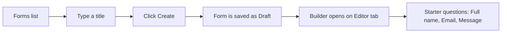
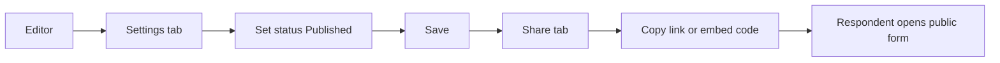

# Form Builder — UX Walkthrough

This document describes what a person actually sees and does today. It is written as a journey, not as code documentation.

## 1. People and entry points

### Club leader / admin
- Signs in at `/{locale}/login`.
- Lands on `/{locale}/admin` (dashboard).
- Opens **Forms** from the sidebar or from the Forms card on the dashboard.
- All forms created by any leader are visible to every leader. There is no per-owner filtering.

### Respondent
- Receives a link such as `https://<site>/fr/f/membership-2026`.
- Opens it on a phone, usually without an account.
- Fills the form once and sees an in-page success message (or is redirected if the form owner configured a redirect).

### Entry points

| From | To |
| --- | --- |
| Admin sidebar → Forms | Forms list |
| Dashboard → Forms card | Forms list |
| Forms list → New form | Form created, then builder |
| Forms list → Edit / form title | Builder, Editor tab |
| Builder header → View form | Public form in a new tab |
| Share tab → Open form | Public form in a new tab |
| Google OAuth callback | Builder, Integrations tab with a status notice |

---

## 2. Journey A — create a form



### What happens

1. The Forms list shows a white card titled **New form** with one text input and a blue **Create** button.
2. The input placeholder is **e.g. Membership 2026** / **ex. Adhésion 2026**.
3. Only the title is asked. The slug is generated automatically from the title. There is no slug field at creation time.
4. On submit the button changes to **Creating…** and is disabled.
5. The form is inserted with status **Draft**, a starter schema of three questions, and default settings.
6. The browser navigates to `/{locale}/admin/forms/{id}` on the **Editor** tab.
7. Errors are shown as a small pink message under the input (missing title, title too long, creation failed).

### Starter questions

| Order | Type | Label | Required |
| --- | --- | --- | --- |
| 1 | Short answer | Full name | Yes |
| 2 | Email | Email | Yes |
| 3 | Long answer | Message | No |

These are real questions and can be edited or deleted. They exist so the live preview is not empty.

---

## 3. Journey B — build and edit questions

### Builder frame

```text
┌──────────────────────────────────────────────────────────────┐
│ ← All forms                                                  │
│ Membership 2026                     [View form] [Save]       │
│ [DRAFT] /membership-2026   Unsaved changes                   │
├──────────────────────────────────────────────────────────────┤
│ Editor | Share | Submissions | Integrations | Settings        │
├──────────────────────────────────────────────────────────────┤
│                                                              │
│  Form description                Question editor (right)    │
│  ┌───────────────────────┐       ┌────────────────────────┐  │
│  │ textarea              │       │ type, label, help...   │  │
│  └───────────────────────┘       └────────────────────────┘  │
│  Questions                                                   │
│  ┌───────────────────────┐       Live preview               │  │
│  │ ↑ ↓ ⧉ ✕  Full name *  │       ┌────────────────────────┐  │
│  │ ↑ ↓ ⧉ ✕  Email *      │       │ title + fields + button │  │
│  │ ↑ ↓ ⧉ ✕  Message      │       └────────────────────────┘  │
│  └───────────────────────┘                                   │
│  [type select] [Add question]                                │
└──────────────────────────────────────────────────────────────┘
```

### Editing behavior

- Every change is local React state. Nothing saves until the user clicks **Save changes**.
- The header shows **Unsaved changes** next to the slug as soon as the schema is modified.
- The **Save changes** button is disabled when there is nothing to save.
- Clicking **Save changes** calls the server, shows a toast **Changes saved**, and hides the unsaved indicator.
- Switching tabs does **not** lose unsaved edits, because the builder stays mounted.
- Leaving the page or refreshing **does** lose unsaved edits. There is no autosave, draft recovery or navigation warning.
- There is no undo/redo.

### Question list

- Questions appear as stacked rows.
- The selected row has a blue border, a light blue tint and a ring.
- Each row shows a type icon, the question label, a pink `*` when required, and the type name underneath.
- Row controls, left to right: move up, move down, duplicate, remove.
- Reordering is button-based. There is no drag and drop.
- Duplicate inserts a copy immediately after the original with new IDs. Labels are copied verbatim.
- Remove deletes instantly, with no confirmation and no undo.
- The list is single-page only. The data model can hold pages, but the UI edits only the first page.

### Add-question control

- A select lists all 13 types, followed by a blue **Add question** button.
- The new question is appended at the end and selected.
- New questions get English default labels such as `Short answer`, `Multiple choice`, `File upload`.

### Question editor (right column)

When a row is selected, a card appears with:

| Control | Behavior |
| --- | --- |
| Question type | Select. Changing type resets type-specific settings but keeps the ID, label, description and required flag. |
| Question | Text input for the label. Empty labels show **Untitled question** in the list. |
| Help text | Optional textarea shown under the label in the public form. |
| Placeholder | Only for text-like types; not shown for choice, rating, statement and file. |
| Required | Checkbox. Adds `*` to the label and blocks empty submission. |
| Options | Only for multiple choice, checkboxes and dropdown. Each option has a text input and a delete button (disabled at two options). **Add option** appends `Option N`. |
| Maximum rating | Only for rating. Number 2–10, default 5. |
| Minimum / Maximum | Only for number. Optional numeric bounds. |
| Max length | Only for short and long text. Optional character limit. |

If no row is selected, the editor column shows: **Select a question to edit it.**

### Live preview (right column, below editor)

- Shows the form title, the form description, every question as it will appear, and a disabled submit button.
- The button label uses the configured submit label, or **Submit**.
- Inputs are disabled and do not submit.
- There is no mobile/desktop preview switch.

### Form description

- A textarea at the top of the Editor tab.
- Maps to the description shown under the title on the public form.
- There is no separate “page title” field in the UI even though the data model has one.

---

## 4. Journey C — publish and share



### Settings tab

The form starts as **Draft**. To accept responses:

1. Open **Settings**.
2. Change **Status** to **Published**.
3. Optionally set **Opens at** / **Closes at**.
4. Click **Save changes**.
5. The page refreshes; the header badge changes to **PUBLISHED** / **PUBLIÉ**.

Alternative states:
- **Archived** behaves like unpublished for the public; the admin can still open it.
- Published + future **Opens at** = public page says the form is closed.
- Published + past **Closes at** = public page says the form is closed.

### Share tab

Shows two cards:

**Share your form**
- Read-only public URL input.
- **Copy link** button → toast **Link copied** or **Could not copy**.
- **Open form** button opens the URL in a new tab.
- If the form is not published, a pink warning appears first: *This form is not published yet. Publish it in Settings to accept responses.* The word **Settings** is a link that switches to the Settings tab.

**Embed on a website**
- Read-only textarea containing:
  `<iframe src="<public URL>" width="100%" height="720" style="border:0" title="Life Savers form"></iframe>`
- **Copy link** button copies the embed code (same label as link copy).
- No width/height controls, no preview of the embed.

### Sharing notes

- The same slug works in both locales: `/fr/f/slug` and `/en/f/slug`.
- The slug can be changed in Settings. Old links stop working.
- The public link is absolute, built from `NEXT_PUBLIC_SITE_URL` or the current host.
- Draft links are technically generated and openable, but show a 404.

---

## 5. Journey D — check results

Open the **Submissions** tab.

### What the user sees

- Title **Submissions**.
- A count: **No responses**, **1 response**, **N responses** (localized plural).
- A **Export CSV** button.
- A horizontally scrollable table.

### Table columns

| Column | Content |
| --- | --- |
| Submitted | Localized date and time, medium date + short time. A green check icon appears when the response was synced to Google Sheets. |
| Respondent | Name and email detected from the first short-text label containing “name”/“nom” and the first email question. Shows `—` when absent. |
| One column per non-statement question | Answer text. Checkboxes are joined with commas. Choice answers are resolved to their labels. File answers become a link to a signed URL (valid one hour). Empty values show `—`. |
| Right edge | Trash icon to delete the row. |

### Behavior and limitations

- Rows are ordered newest first.
- The tab loads the latest **500** responses. CSV export includes all responses.
- Delete asks for confirmation with a native browser dialog, then redirects back to the Submissions tab.
- There is no search, filter, date range, pagination, sorting, response detail drawer, chart or “mark as read”.
- File links expire after one hour and are regenerated when the page is reloaded.
- The respondent name/email detection is heuristic, not a configured field mapping.

### CSV

- UTF-8 with BOM so Excel opens accents correctly.
- Columns: Submitted at, Name, Email, one column per non-statement question, Synced to Google Sheets (`yes`/`no`).
- Filename: `<slug>-responses.csv`.
- Only signed-in leaders can download it.

---

## 6. Journey E — connect Google Sheets

Open the **Integrations** tab.

### When Google is not configured on the server

- The Google Sheets card shows an explanation and a muted note listing the required environment variables.
- **Connect Google Sheets** is not shown.

### When configured and not connected

- Card shows **Google Sheets** title, a short explanation, and a blue **Connect Google Sheets** button.
- The button starts a Google OAuth flow (spreadsheet and drive-file scopes only).
- After approval:
  - A spreadsheet named **Life Savers – <form title>** is created.
  - A header row is written with **Submitted at** and each question label.
  - The form is linked to the sheet.
  - The builder returns to the Integrations tab with a green **Google Sheets connected.** banner.
- On failure the builder returns with a pink **Google Sheets connection failed. Please try again.** banner.

### When connected

- Green **Connected** pill.
- **Open spreadsheet** opens `docs.google.com/spreadsheets/d/<id>`.
- **Reconnect** restarts OAuth and replaces the sheet.
- **Disconnect** asks for confirmation, then clears the link (the Google spreadsheet itself is kept).
- A **How it works** list explains the three steps.
- A muted note says only new responses are synced; existing responses are not backfilled.

### Sync behavior

- One-way: app → sheet.
- Each new response appends a row with the submission timestamp and one cell per non-statement question.
- Files are written as the original filename.
- Checkboxes are joined with commas.
- If sync fails, the response is still saved and the green check is absent.
- There is no “sync now”, retry queue or error detail per response.

---

## 7. Journey F — settings, rename, close, delete

Settings contains:

| Field | Notes |
| --- | --- |
| Title | Shown as the public H1 and in the admin list. Required, max 200. |
| Public URL slug | Lowercase letters, numbers and dashes. Must be unique. Editing breaks old links. |
| Status | Draft / Published / Archived. |
| Opens at / Closes at | Optional `datetime-local`. Both empty = always open. Closing must be after opening. |
| Submit button label | Optional. Falls back to **Submit** / **Envoyer**. |
| Redirect after submit | Optional absolute `http(s)` URL. If set, respondents leave the app after submitting. |
| Confirmation title | Optional. Falls back to **Thank you!** / **Merci !**. |
| Confirmation message | Optional. Falls back to a default confirmation sentence. |

- **Save changes** shows a spinner label **Saving…**, then an inline green **Settings saved** message; the header refreshes.
- Validation errors appear inline in pink, using translation keys (title required, slug taken, slug invalid, closing date order, redirect invalid, save failed).
- **Danger zone** explains that deleting the form also deletes every response. **Delete form** asks for native confirmation and returns to the list.

---

## 8. Journey G — the respondent

### Layout

- Full-screen light grey background.
- A blue-to-pink gradient band across the top.
- White Life Savers logo and wordmark on the left, tagline on the right (desktop only).
- A white card overlaps the gradient.
- The H1 is the form title.
- The form description appears under it, then a short gradient rule.
- Questions follow, then a full-width blue submit button.
- A small **Powered by Life Savers** line sits under the card.
- No site header, footer or navigation.

### Filling

- Text, email, phone, number, URL and date inputs use native controls.
- Long answers use a four-row textarea.
- Multiple choice and checkboxes render as bordered option rows.
- Dropdown uses a native select with a disabled placeholder option.
- Rating renders as circular number buttons 1–5 (or the configured max), filled blue when selected.
- File upload uses a dashed drop-zone-looking input with a blue file-picker button.
- Text blocks render as dashed boxes with a title and paragraph.
- Required questions show a pink `*`.

### Submitting

1. The button changes to **Sending…** and disables.
2. Server-side validation runs again, including required fields, email/phone/URL format, numeric bounds, choice validity, max length and a 10 MB file limit.
3. On success the form is replaced by a green confirmation card with a check icon, the configured title and message.
4. On failure a pink banner appears above the button with the translated error and the question label.
5. If the owner set a redirect URL, the browser leaves the page instead of showing the confirmation card.
6. There is no “Submit another response” action and no response receipt by email.

### Closed / invalid states

- If the form is draft, archived or missing, the public route returns a 404.
- If the form is published but outside its open window, the card shows **This form is closed** and an explanation; the questions are hidden.
- If the schema has no questions, the form shows a muted “no questions yet” note and still shows the submit button.

---

## 9. What persists, and when

| Action | Saved immediately? |
| --- | --- |
| Creating a form | Yes |
| Editing questions / description | No, until **Save changes** |
| Reordering, duplicating, deleting questions | No, until **Save changes** |
| Changing settings | Yes, on **Save changes** in Settings |
| Publishing / archiving | Yes, on **Save changes** in Settings |
| Deleting a form | Yes, immediately after confirmation |
| Deleting a response | Yes, immediately after confirmation |
| Disconnecting Google Sheets | Yes, immediately after confirmation |
| Submitting a public response | Yes, immediately |
| Editing a form on another device/tab | Last save wins; there is no conflict warning |

---

## 10. Current friction points worth redesigning

1. **Save is global but tabs are not.** Users can edit in Editor, switch to Share, and see no reminder that changes are still unsaved except the small header label.
2. **No autosave or draft recovery.** Closing the tab loses work.
3. **Tabs are not reflected in the URL** except on first load (`?tab=`). Refreshing returns to Editor, and browser back does not move between tabs.
4. **No drag-and-drop reordering.** Up/down buttons get slow with long forms.
5. **No multi-page support in the UI** even though the schema supports pages.
6. **Question deletion is instant** with no confirmation or undo.
7. **No form duplication or templates.**
8. **Submissions are a raw table.** No response detail, search, filter, pagination or charts; only the latest 500 are loaded.
9. **Heuristic respondent name/email.** The admin cannot choose which questions populate those columns.
10. **File links expire** after one hour with no explanation.
11. **Native `window.confirm` dialogs** for every destructive action feel out of place.
12. **Draft preview is not possible.** **View form** opens the public URL and shows a 404 for drafts.
13. **Embed controls are fixed** at 100% × 720 with no preview.
14. **No unsaved-changes warning** when navigating away.
15. **Accessibility gaps:** tab strip is a set of buttons rather than an ARIA tablist; error banners lack `aria-live`; icon-only controls rely on `title`/`aria-label`; focus is not moved to the first invalid question after submission.
16. **No response confirmation email** or copy of answers to the respondent.
17. **Google Sheets has no sync status or retry**, and no backfill for existing responses.
